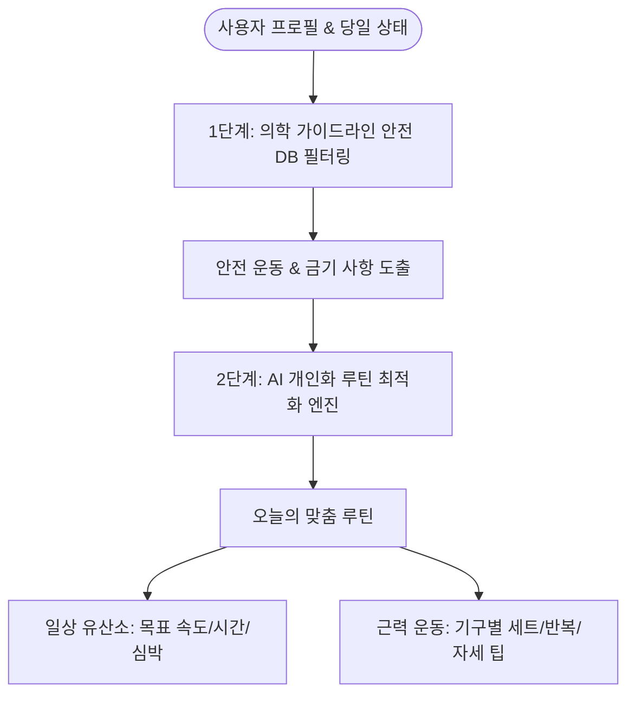
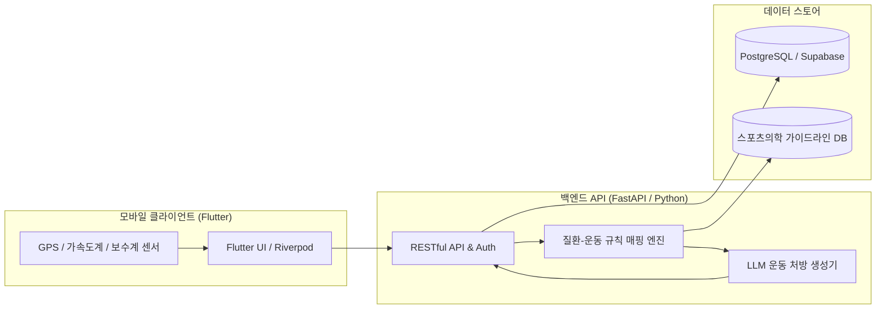

# [PRD] My-Care: 질환 맞춤형 운동 처방 및 지속 관리 플랫폼

> **프로젝트 코드명**: My-Care  
> **버전**: v0.1 (MVP 기획안)  
> **문서 상태**: 검토 및 사용자 승인 대기  
> **작성일자**: 2026-11-04  

---

## 1. 기획 배경 및 문제 정의 (Background & Problem)

### 1.1 배경
- 건강검진 후 **지방간, 전당뇨, 고혈압, 고지혈증** 등의 만성·대사성 질환 진단을 받는 인구가 급증하고 있습니다.
- 의사나 전문가는 "운동하세요"라고 권고하지만, 환자 개개인은 **"어떤 운동을, 얼마나 빠르게, 몇 분 동안, 어떤 기구로 해야 하는지"** 명확한 처방을 받기 어렵습니다.

### 1.2 핵심 문제점 (Pain Points)
1. **질환별 운동 처방의 구체성 부재**:
   - 똑같은 "걷기"라도 일반인과 지방간 환자(중강도 지속 유산소 필요), 전당뇨 환자(식후 혈당 스파이크 억제를 위한 걷기 타이밍 및 속도 필요)에게 필요한 강도와 시간, 심박수 구간이 완전히 다릅니다.
2. **운동 위험성 및 금기 운동 인지 부족**:
   - 특정 질환이나 관절 상태에 따라 피해야 할 운동(예: 망막병증 환자의 발살바 호흡 무산소 운동, 관절염 환자의 과도한 런지/레그프레스 각도 등)이 있으나 이를 사전에 경고해 주는 서비스가 부족합니다.
3. **지속성의 실패**:
   - 맞춤 추천 운동(헬스 기구, 맨몸 운동, 홈트레이닝 등)과 일상 걷기 운동이 유기적으로 연계되지 않아 동기부여가 쉽게 저하됩니다.

---

## 2. 제품 비전 및 핵심 가치 (Vision & Value Proposition)

> **"내 질환에 딱 맞는 안전하고 과학적인 운동 처방과 지속 가능한 루틴 관리"**

- **안전성(Safety First)**: 스포츠의학 및 공인 학회(대한당뇨병학회, 간학회, ACSM 등) 가이드라인 기반의 안전한 처방
- **개인화(Hyper-Personalization)**: 정형화된 DB 규칙에 생성형 AI를 결합하여 사용자의 일상 환경(장소, 시간, 기구 보유 여부)에 맞춘 유연한 루틴 제시
- **실천성(Actionable & Trackable)**: 스마트폰 센서를 활용한 실시간 걷기 템포/시간 가이드 및 직관적인 루틴 체크리스트

---

## 3. 타겟 페르소나 (Target Persona)

| 구분 | 주요 특징 및 니즈 |
| :--- | :--- |
| **페르소나 A (3040 직장인)** | 건강검진에서 **지방간 및 전당뇨** 경고를 받고 헬스장에 등록했으나, 어떤 기구를 몇 세트 해야 내 간/혈당 수치 개선에 도움 되는지 헷갈리고, 퇴근 후 걷기 운동의 적정 속도를 알고 싶음 |
| **페르소나 B (5060 액티브 시니어)** | 고혈압/관절염 등 복합 질환을 앓고 있어 무리한 운동은 겁나고, 혈압을 올리지 않으면서 효과적인 유산소 걷기 가이드 및 무릎에 부담 없는 하체 운동을 찾음 |

---

## 4. MVP 핵심 기능 명세 (Core Features)

### 4.1 건강 프로필 및 질환 진단 온보딩
- **보유 질환/증상 선택**: 지방간(NAFLD/NASH), 전당뇨(공복혈당/내당능장애), 고혈압, 고지혈증, 관절 이슈 등
- **현재 활동 수준**: 비운동군, 주 1~2회, 주 3회 이상
- **보유 운동 환경**: 헬스장 이용 여부, 야외 걷기/러닝, 홈트레이닝

### 4.2 하이브리드 운동 추천 엔진
- **1단계 (Rule-Based 안전 필터)**: 학회 가이드라인 기반 질환별 권장/금기 운동 매핑
- **2단계 (AI 개인화 루틴 생성)**: 사용자의 당일 컨디션, 가용 시간, 장소에 맞춰 실시간 루틴 조합 및 설명 제공

### 4.3 일상 유산소 맞춤 가이드 (Walking & Cardio Coach)
- **질환별 타겟 가이드**:
  - 전당뇨: 식후 30분~1시간 이내 중등도 속보(100~120 SPM, 30분 이상)
  - 지방간: 내장지방 연소를 위한 주 150분 이상 유산소(최대심박수의 60~70% 유지 구간)
- **실시간 인터페이스**:
  - 목표 분당 걸음수(Cadence/SPM) 메트로놈/진동 피드백
  - 타이머 및 칼로리/거리 실시간 트래킹

### 4.4 질환 맞춤 저항성/근력 운동 가이드 (Strength & Functional Guide)
- 환경별 맞춤 가이드: 헬스장 기구(레그프레스, 체스트프레스, 랫풀다운 등), 홈트 소도구(덤벨/밴드), 맨몸 운동(스쿼트, 월싯, 푸시업 변형) 지원
- 질환별 맞춤 볼륨 설정: 인슐린 감수성 개선을 위한 하체/대근육 중심 루틴, 간 내 지방 연소를 돕는 중등도 서킷 구성
- 위험 동작 및 주의사항: 질환별 금기(혈압 급상승 유발 동작, 호흡 참기, 무릎/허리 과부하) 사전 필터링 및 대체 동작 안내

### 4.5 지속 루틴 트래커 (Habit & Retention)
- 일일/주간 운동 달성도 스트릭(Streak)
- 건강 지표 추이(체중, 걸음수, 운동 누적 시간)

---

## 5. 시스템 아키텍처 및 기술 스택 제안

- **클라이언트**: **Flutter (Dart)** (사용자 로컬 환경에 Flutter SDK 세팅 완료, iOS/Android 크로스플랫폼, 센서 연동 우수)
- **백엔드**: **FastAPI (Python)** (의학 데이터 처리, 추천 알고리즘 및 LLM 연동에 최적화)
- **데이터베이스**: PostgreSQL / SQLite (초기 로컬 프로토타입)

---

## 6. 개발 단계별 로드맵 (Milestones)

- [ ] **M1. 기획안 승인 및 데이터 모델링**: 질환별 운동 권장 가이드라인 DB 스키마 설계
- [ ] **M2. 백엔드 추천 API 프로토타입**: 지방간/전당뇨 맞춤 규칙 기반 + AI 처방 엔드포인트 구현
- [ ] **M3. Flutter 모바일 앱 UI 구현**: 온보딩, 유산소 타이머/걸음수 인터페이스, 근력 운동 카드
- [ ] **M4. 센서 연동 및 통합 테스트**: 실시간 걸음 속도/시간 측정 및 루틴 기록 테스트
- [ ] **M5. 배포 및 사용자 검증**: 앱 패키징 및 실 사용자 피드백 반영

---

> [!TIP]
> 위 기획안 내용 중 수정하고 싶으시거나 추가하고 싶은 사항이 있으시면 편하게 말씀해 주세요.  
> 기획안이 마음에 드시면 상단의 **Proceed** 버튼을 누르거나 메시지를 주시면 다음 단계인 **데이터 모델 및 아키텍처 설계**로 즉시 착수하겠습니다.
